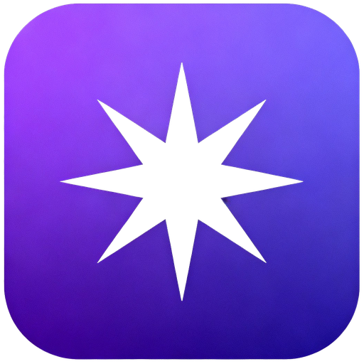

# AI Workspace



**面向校园的多模态 AI 生成中台 —— 基于 [New API](https://github.com/QuantumNous/new-api) 构建**

[功能特性](#功能特性) · [快速开始](#快速开始) · [部署](#部署) · [二次开发](#二次开发) · [文档与参考](#文档与参考)

---

## 项目简介

AI Workspace 是面向校园教学场景的多模态 AI 生成中台，以 [New API](https://github.com/QuantumNous/new-api)（QuantumNous）为底座构建：底层复用其网关的渠道路由、限流、缓存与额度预扣机制，支撑课堂场景下 400–500 并发的瞬间请求量；上层在同一 Go 服务内实现**双皮肤架构**——学生端保留紫色主题的创作界面，教师端与管理端沿用 New API 控制台的成熟管理样式。

系统提供三级角色体系：**学生端**、**教师端**（普通版 / 专业版）、**管理端**（超级管理员）。计费模式为**按调用次数计费**：每个生成功能独立配置单次消耗点数，学生持有一个总点数钱包；管理端提供模型定价与月度对账，可按学生、按班级、按教师统计消费总额并与 API 接入侧总价对账。

生成产物（文字、图片、视频、音频）统一存储在本地磁盘，通过受鉴权的内网接口分发，**不依赖任何对象存储与 CDN**，可纯内网部署。

本 README 描述当前源码树，具体功能以所部署版本的发布说明为准，当前版本号见 [VERSION](./VERSION)。

> [!IMPORTANT]
> - This project is intended solely for lawful and authorized AI API gateway, organization-level authentication, multi-model management, usage analytics, cost accounting, and private deployment scenarios.
> - Users must lawfully obtain upstream API keys, accounts, model services, and interface permissions, and must comply with upstream terms of service and applicable laws and regulations.
> - When providing generative AI services to the public, users should comply with applicable regulatory requirements and fulfill all filing, licensing, content safety, real-name verification, log retention, tax, and upstream authorization obligations required by their jurisdiction.

> [!WARNING]
> When operating this project as a public generative AI service or API resale service, users should first complete all required filing, licensing, content safety, real-name verification, log retention, tax, payment, and upstream authorization obligations.

## 功能特性

| 板块 | 说明 |
| --- | --- |
| 多模态生成 | 文生文、文生图、图生图、视频生成、音乐生成、语音合成；模型按「生成能力」逐个声明并独立配置开放范围（学生 / 教师） |
| 实验室 | HTML 编程实验室（Beta）、演示实验室（Beta），可在小班维度独立开关，支持全局默认思考强度 |
| 教学管理 | 学部 / 年级 / 班级 / 小班（正课 + 社团）、Excel 批量导入、备课与课时任务、上课模式、课堂数据大屏与投屏、学情统计 |
| 角色权限 | 学生（年级 + 账户名登录）、教师（仅限本人班级与学生）、管理端三级权限；支持企业微信、飞书扫码绑定登录 |
| 点数计费 | 按次扣点：每个生成功能独立配置单次消耗点数；学生总点数钱包；点数不足时生成入口自动置灰 |
| 模型定价 | 平台设置、能力点数、模型倍率与上游定价（倍率 × 汇率自动换算单价）；月度对账支持学生 / 班级 / 教师维度汇总 |
| 网关能力（继承 New API） | 渠道管理、模型倍率与分段计价、限流与额度、API Key 与 OAuth/OIDC、Passkey、两因素认证；OpenAI / Anthropic / Gemini 多协议接入 |
| 界面语言 | 简体中文、English |

### 协议与端点

| 接口 | 常用端点 |
| --- | --- |
| OpenAI Chat / Responses | `POST /v1/chat/completions`、`POST /v1/responses` |
| Anthropic Messages | `POST /v1/messages` |
| Gemini | `POST /v1beta/models/{model}:generateContent`、`POST /v1beta/models/{model}:streamGenerateContent` |
| Images / audio | `/v1/images/generations`、`/v1/images/edits`、`/v1/audio/speech`、`/v1/audio/transcriptions` |
| Embeddings / rerank | `POST /v1/embeddings`、`POST /v1/rerank` |
| Task plugins | `POST /v1/tasks/{pluginKey}`、`GET /v1/tasks/{taskId}`，以及各插件声明的自有路由 |

[RelayKit](./relaykit/README.md) 负责四种文本协议之间的请求、响应与流式转换；可用能力取决于渠道、上游模型与转换路径。WebSocket 还需要上游与渠道配置支持。

## 快速开始

### 方式一：Docker Compose（推荐）

```bash
# 进入仓库根目录
docker compose up -d --build
docker compose logs -f aiworkspace
```

打开 [http://localhost:3002](http://localhost:3002) 完成初始化向导，创建管理员账号。

> [!WARNING]
> `docker-compose.yml` 内置的是**示例密码**（PostgreSQL / Redis）与默认会话配置，生产部署前必须修改；另有 [docker-compose.prod.yml](./docker-compose.prod.yml)（使用服务器已装的 PostgreSQL / Redis）与 [docker-compose.dev.yml](./docker-compose.dev.yml)（开发栈）可选。
>
> 必须使用**本仓库的 Dockerfile** 构建镜像——AI Workspace 的全部定制（双皮肤、教学增强、素材本地存储等）都在上游 `calciumion/new-api` 镜像之外，直接拉取上游镜像会丢失全部定制功能。

### 方式二：Windows 免环境 exe

发布包提供免环境单文件 exe：将其与 `one-api.db` 放在同一目录双击即可启动（未设置 `SQL_DSN` 时默认使用同目录的 SQLite 文件），浏览器访问 [http://localhost:3002](http://localhost:3002)。

### 方式三：源码运行

后端为 Go，前端为 React 19 + Rsbuild；先构建前端（后端通过 `go:embed` 内嵌 `web/dist`）：

```bash
# 仓库根目录
cd web
bun install --frozen-lockfile
bun run build
cd ..
go run .            # 默认监听 3002 端口
```

开发时另开终端启动前端开发服务器：

```bash
cd web
bun run dev -- --port 5173
```

打开 [http://localhost:5173](http://localhost:5173)；开发服务器将 API 请求代理到 3002 端口的后端。

### 发起第一个请求

1. 在管理端添加渠道（上游 API Key、可用模型、分组），执行渠道测试。
2. 配置模型定价，并确保用户有点数或有效额度。
3. 在控制台创建 API Key，与渠道分组、模型范围一致。
4. 客户端 base URL 填 `http://localhost:3002/v1`，使用控制台签发的 Key。

```bash
curl --fail-with-body http://localhost:3002/v1/models \
  -H "Authorization: Bearer ${NEW_API_KEY}"
```

```bash
curl --fail-with-body http://localhost:3002/v1/responses \
  -H "Authorization: Bearer ${NEW_API_KEY}" \
  -H "Content-Type: application/json" \
  -d '{"model":"your-enabled-model","input":"Hello!"}'
```

## 部署

### 生产环境：完整操作教程

生产部署请直接按 [DEPLOY_GUIDE.md](./DEPLOY_GUIDE.md) 操作，覆盖完整链路：

```
源码 zip → 构建电脑 docker build（三阶段，容器内编译前端 + Go）
        → docker save 导出 tar → 业务服务器 docker load 导入
        → docker run 启动（数据持久化在宿主机 /opt/aiworkspace/data）
```

要点：

- 业务服务器**只需 Docker**，不需要源码与编译环境；
- 数据库与生成产物缓存固定挂载宿主机 `/opt/aiworkspace/data`，**删除容器不丢数据**；
- 服务端口 **3002**（需在云安全组 / 防火墙放行）；
- 版本更新口诀：备份 → 停旧容器 → 删旧容器 → 导入新 tar → 用同一启动命令拉起新容器。

### Docker Compose 组成

[Compose 配置](./docker-compose.yml)默认启动 **AI Workspace + PostgreSQL + Redis**（项目名 `aiworkspace`），并附 MySQL 与独立 ClickHouse 日志库的示例。启动前修改数据库 / Redis 密码与持久化 `SESSION_SECRET`（`openssl rand -hex 32` 生成）；HTTPS 控制台需配置 `SESSION_COOKIE_SECURE=true` 与 `SESSION_COOKIE_TRUSTED_URL`。

### 存储与配置

| 组件 | 选项 |
| --- | --- |
| 主数据库 | SQLite、MySQL ≥ 5.7.8 或 PostgreSQL ≥ 9.6 |
| 独立日志库 | 通过 `LOG_SQL_DSN` 配置，支持 ClickHouse |
| 缓存 | 可选 Redis + 内存缓存；多节点共享限流需用同一 Redis |
| 容器平台 | Linux amd64 / arm64 |
| 生成产物 | 本地磁盘（`WORKSPACE_ARTIFACT_DIR`），无对象存储依赖 |

| 环境变量 | 用途 |
| --- | --- |
| `SQL_DSN` | 主数据库连接；不设置则使用 SQLite |
| `LOG_SQL_DSN` | 可选的独立日志数据库连接 |
| `REDIS_CONN_STRING` | Redis 连接串 |
| `SESSION_SECRET` | 持久化会话密钥；多节点必须一致 |
| `CRYPTO_SECRET` | 默认同 `SESSION_SECRET`；共享 Redis 的节点必须一致 |
| `SESSION_COOKIE_SECURE` | HTTPS 控制台设为 `true` |
| `SESSION_COOKIE_TRUSTED_URL` | Secure 模式必填：精确 HTTPS Origin 列表，不含路径与通配符 |
| `TRUSTED_PROXIES` | 受信反向代理 IP/CIDR，或 `none` |

完整变量见 [环境示例](./.env.example)、[环境变量参考](https://docs.newapi.ai/en/docs/installation/config-maintenance/environment-variables) 与 [认证与会话指南](./docs/authentication.md)。生产环境请将控制台置于 HTTPS 之后，配置反向代理的流式与 WebSocket 转发，持久化并备份数据库与挂载数据。

## 二次开发

后端使用 Go + Gin；Web 控制台使用 React 19、TypeScript、Rsbuild、TanStack 与 Tailwind CSS 4。前端依赖与脚本一律使用 Bun。Go 语言基线见 [go.mod](./go.mod)，容器构建链见 [Dockerfile](./Dockerfile)。

| 目录 | 职责 |
| --- | --- |
| `router/`、`middleware/`、`controller/` | HTTP 路由、访问校验与 API 处理器 |
| `relay/` | 上游适配与请求转发 |
| `service/`、`model/` | 业务逻辑与持久化 |
| `setting/` | 平台配置（含 AI Workspace 定价、点数等业务配置） |
| [relaykit/](./relaykit/README.md) | 独立可构建的协议 DTO 与转换 Go 模块 |
| [plugins/tasks/](./plugins/tasks/) | JavaScript 任务插件；见 [Task Plugin API v1](./docs/plugin-api/v1.md) |
| `web/` | Web 控制台；见 [前端规范](./web/AGENTS.md) |
| [electron/](./electron/README.md) | 桌面壳与打包 |

改动前请阅读 [AGENTS.md](./AGENTS.md)。Go 侧按改动范围执行 `make test`；前端改动需在 `web/` 下通过 `bun check -b`、`bun run lint`、`bun run test`、`bun run build`。涉及 `relaykit/` 的改动还必须在 `relaykit/` 目录执行 `GOWORK=off go build ./...`。

## 文档与参考

| 资源 | 链接 |
| --- | --- |
| 构建与部署教程 | [DEPLOY_GUIDE.md](./DEPLOY_GUIDE.md) |
| 站内操作教程 | 管理端「文档」入口内的班级与授课配置图文教程 |
| 前端规范 | [web/AGENTS.md](./web/AGENTS.md) |
| 任务插件 API | [Task Plugin API v1](./docs/plugin-api/v1.md) |
| 上游 New API 文档 | [Guides](https://docs.newapi.ai/en/docs) · [Installation](https://docs.newapi.ai/en/docs/installation) · [API reference](https://docs.newapi.ai/en/docs/api) |
| 常见问题 | [FAQ](https://docs.newapi.ai/en/docs/support/faq) |
| 安全报告 | 按 [安全策略](./.github/SECURITY.md) 私下反馈 |

---

## 许可证

This project is licensed under the [GNU Affero General Public License v3.0 (AGPLv3)](./LICENSE).

Additional terms under AGPLv3 Section 7 apply. Modified versions must preserve
the author attribution notice `Frontend design and development by New API
contributors.` in the appropriate legal notices and in any prominent about,
legal, footer, or attribution location presented by the user interface.

Modified versions that present a user interface must also preserve a visible
link to the original project: <https://github.com/QuantumNous/new-api>.

This is an open-source project developed based on [One API](https://github.com/songquanpeng/one-api) (MIT License).

If your organization's policies do not permit the use of AGPLv3-licensed software, or if you wish to avoid the open-source obligations of AGPLv3, please contact us at: [support@quantumnous.com](mailto:support@quantumnous.com)

See [NOTICE](./NOTICE) and [third-party licenses](./THIRD-PARTY-LICENSES.md) for attribution and dependency notices.
