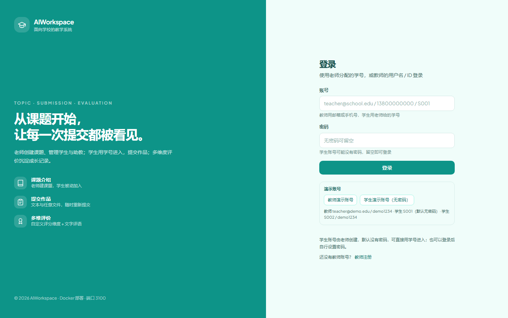
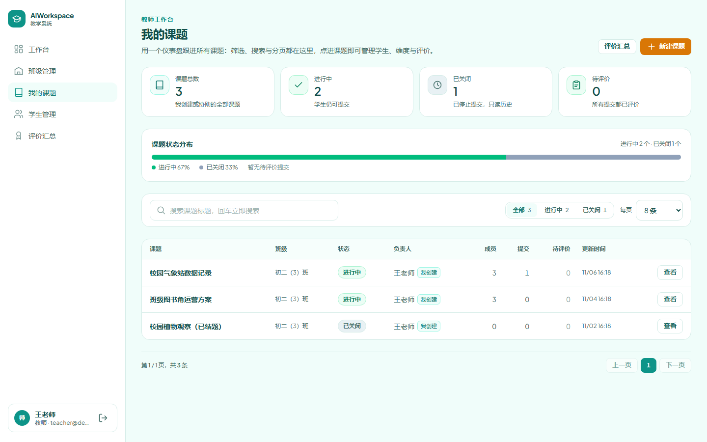
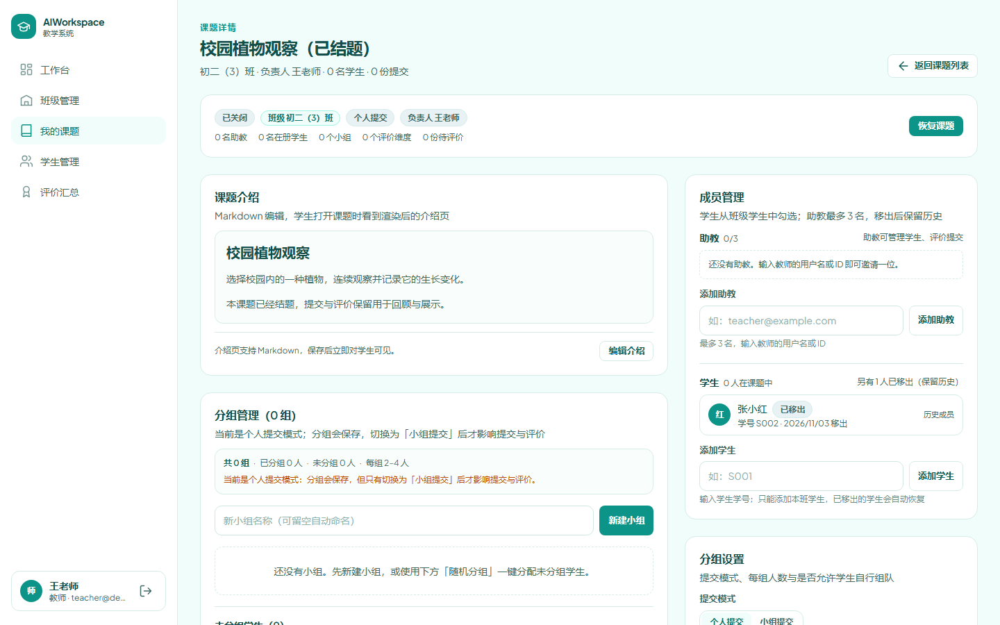
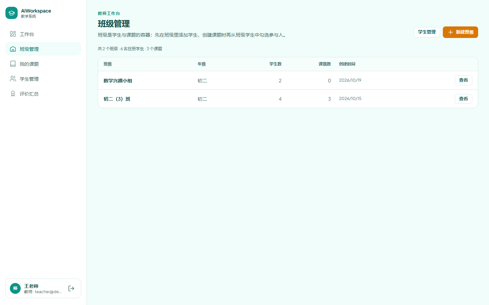
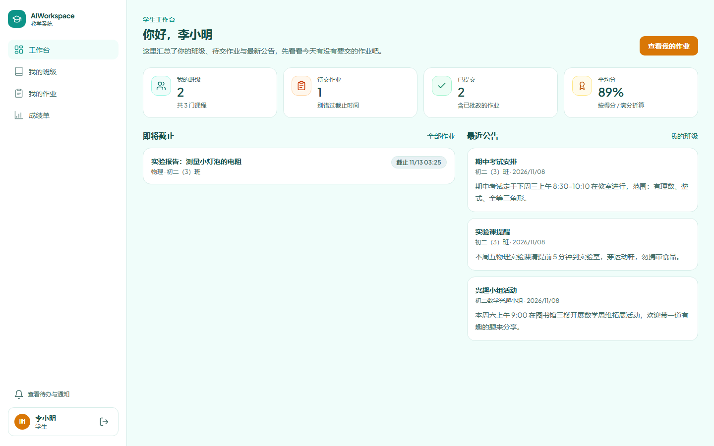
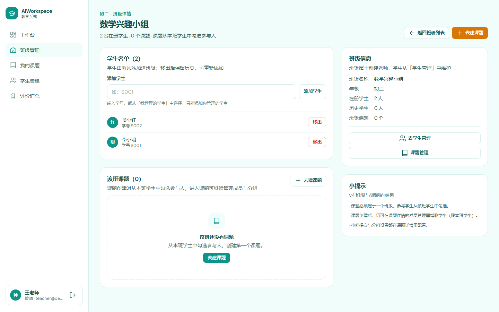
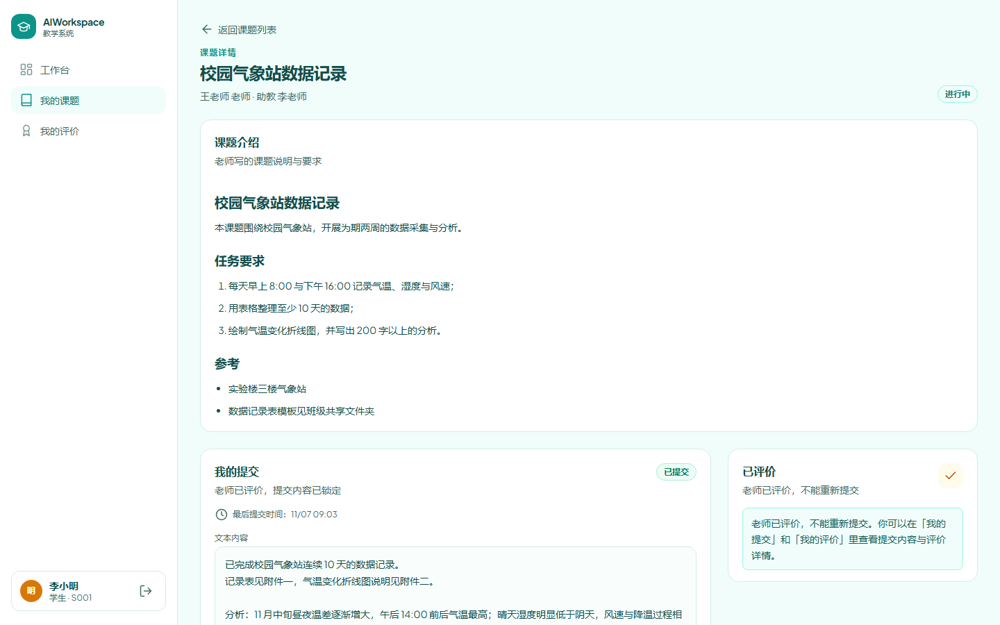
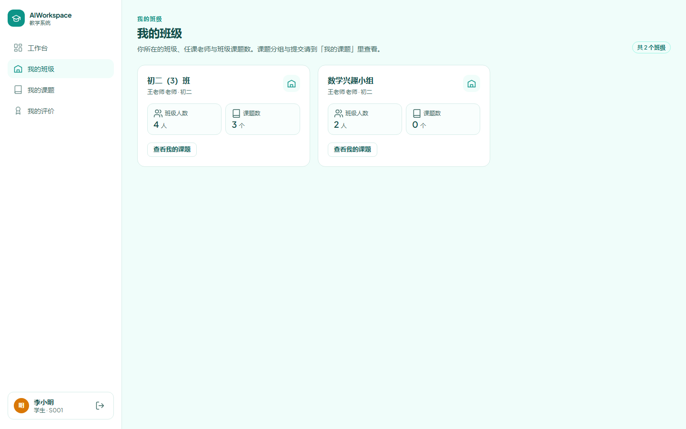

# AIWorkspace · 教学系统（课题 · 提交 · 评价）

面向学校 **教师** 与 **学生** 的轻量网页教学系统：老师创建班级与课题、管理学生与助教；学生用学号进入，提交作品（文本 + 任意文件）；老师进行多维度评分与文字评价；课题支持分组与小组提交。

技术栈：**Go 1.27**（标准库 HTTP + 纯 Go SQLite）+ **React 19 / Vite / TypeScript / Tailwind CSS v4**；单容器 Docker 部署，宿主机 **3100 端口** 访问。

> Git 远端：`https://github.com/Williamwei20130122/AIWorkspace`
> 历史版本：v1 Next.js 全栈在 `feat/project-base`；v2 班级/作业模型在 `feat/go-ts`；当前 v4 在 `feat/topic-model`。

---

## 1. 产品模型

**班级（Class）→ 课题（Topic）→ 提交（Submission）→ 评价（Evaluation）**

- **班级**：老师创建班级并添加学生；课题属于班级，创建课题时从班级学生中勾选参与人。
- **分组**：课题可选择「个人提交 / 小组提交」；每组人数上下限可配置；老师可建组/随机分组，学生也可自行组队（可开关）；小组提交时组员共享提交与评价。
- **评价**：老师自定义评分维度 + 文字评语，可多次评价；老师评价后提交锁定。

### 教师端

- **账号**：用**邮箱或手机号**注册 / 登录（自助注册）
- **班级管理**：创建班级、添加/移出学生（保留历史）、查看班级课题
- **课题**：选择班级创建，从班级学生中勾选参与人；Markdown 介绍页；关闭/恢复课题
- **课题管理**：仪表盘（统计 + 状态分布）+ 标题搜索 + 状态筛选 + 分页表格
- **协作**：邀请**最多 3 名助教**共同管理；创建者权限**可移交**
- **分组**：提交模式（个人/小组）、每组人数上下限、允许学生自组开关；建组/改名/删组/加人/移出/随机分组
- **学生管理**：创建学生账号（姓名 + 默认用户名）；学生可被多位老师管理；
  - 用户名冲突时先展示已有账号信息，由老师判断「同一个人 → 加入我的管理」或「不同人 → 换用户名重新创建」
  - 可重置 / 关闭学生密码，但**永远看不到明文**
- **成员**：把学生加入/移出课题（学生被动加入，不能自行进出；移出后保留历史）
- **评价**：自定义课题的**多维评分维度** + 文字评语；一个提交可多次评价、保留历史
- **工作台**：待评价队列、最近评价、我的课题紧凑表格
- **评价汇总**：查看自己课题下的全部评价

### 学生端

- **登录**：老师分配的**默认用户名（学号）**直接登录，默认无密码；可自行设置/清除密码
- **我的班级**：查看所在班级
- **工作台**：课题状态筛选（全部/未提交/已提交）+ 最近评价 + 账号安全
- **我的课题**：当前课题 + 曾经加入过的历史课题
- **课题介绍页**：Markdown 渲染
- **分组**：我的小组与组员；允许学生自组时可创建/加入/退出小组；小组提交需满足人数下限
- **提交**：文本（原样展示，不渲染 Markdown/LaTeX）+ 任意类型文件多文件上传；个人提交或小组共享提交
- **已评价锁定**：老师评价后不能重新提交（防篡改）
- **我的评价**：查看自己全部历史评价（多维得分 + 评语）

### 演示账号（首次启动自动创建）

| 角色 | 账号 | 密码 |
| --- | --- | --- |
| 教师 | `teacher@demo.edu` | `demo1234` |
| 教师（助教） | `li@demo.edu` | `demo1234` |
| 学生 | `S001`（李小明） | 无密码，直接登录 |
| 学生 | `S002`（张小红） | `demo1234` |

### 界面预览

| 登录 | 教师工作台 | 课题管理（仪表盘） |
| --- | --- | --- |
|  |  |  |

| 课题详情（教师，含分组） | 班级管理 | 学生工作台 |
| --- | --- | --- |
|  |  |  |

| 班级详情 | 学生课题详情（小组） | 学生我的班级 |
| --- | --- | --- |
|  |  |  |

截图在 [`docs/screenshots/`](docs/screenshots/)，由 `node scripts/capture-screenshots.mjs` 自动生成。

### 当前状态

- v4（班级 + 课题分组 + 小组提交）已完成：Go 后端 + React 前端 + Docker 单容器 3100
- 验证：后端 `go vet/build/test` 通过；班级/分组/小组提交端到端 148 项通过；容器内页面与 API 实测通过
- Git：`feat/topic-model` 分支 → PR #2（draft）
- 浏览器插件 BrowserSkill 已接入（CLI + DSH 插件）；浏览器扩展需手动安装

---

## 2. 技术栈与结构

| 层 | 选型 |
| --- | --- |
| 后端 | Go 1.27，`net/http` 路由；`modernc.org/sqlite`（纯 Go，无需 CGO） |
| 前端 | React 19 + Vite + TypeScript strict + Tailwind CSS v4 + React Router 7 |
| 认证 | scrypt 口令哈希 + HMAC-SHA256 签名 HttpOnly Cookie（`aw_session`）；学生账号可无密码 |
| 数据 | SQLite：本地 `server/data/app.db`，容器 `/data/app.db`；上传文件 `uploads/` |
| 部署 | Docker 多阶段：Vite 构建 → Go 构建（`go:embed` 内嵌前端）→ alpine |

```
server/                    Go 后端
  cmd/server/main.go       入口（环境变量、建库、种子、HTTP 服务、内嵌前端）
  internal/db/             schema.sql、建库、种子
  internal/auth/           scrypt、会话签名、鉴权中间件
  internal/handlers/       auth / teacher / student / health
  internal/models/         JSON 结构体
  webdist/                 go:embed 的前端产物（构建时由 web/dist 覆盖）
web/                       Vite + React 前端
  src/pages/               页面（teacher/、student/、Login、Register）
  src/components/          ui、shell、auth、teacher、student
  src/lib/                 api、types、format、roles
docs/                      需求、架构、设计系统、开发契约、截图
scripts/                   本地启动、截图等开发脚本
Dockerfile / docker-compose.yml
```

---

## 3. 本地开发

环境要求：**Go 1.27+**、**Node.js 22+**、npm 10+。

### 后端（:3100）

```powershell
# PowerShell 示例
$env:AUTH_SECRET="dev-secret-change-me"
$env:DATABASE_PATH="./data/app.db"
$env:UPLOAD_DIR="./data/uploads"
$env:SEED_ON_START="1"
pwsh -File scripts/dev-server.ps1
```

健康检查：`http://localhost:3100/api/health`。

### 前端（:5173，自动代理 /api 到 :3100）

```bash
cd web
npm install
npm run dev
```

打开 http://localhost:5173 ，用演示账号登录。

### 生产构建（单端口 3100）

```bash
cd web && npm ci && npm run build
# 复制 web/dist 到 server/webdist 后再编译（go:embed 需要）
cd ../server && go build -o ../aiworkspace ./cmd/server
```

> 直接 `docker compose up -d --build` 会自动完成前后端构建与内嵌。

---

## 4. Docker 部署（3100 端口）

```bash
cp .env.example .env     # 修改 AUTH_SECRET 为随机值
docker compose up -d --build
docker compose logs -f web
# 打开 http://localhost:3100
```

- 端口映射 `3100:3100`（容器内 Go 服务监听 3100）。
- 数据持久化：命名卷 `aiworkspace-data` → `/data`（`app.db` + `uploads/`）；`down` 不丢数据，`down -v` 重置。
- 空库首次启动自动写演示数据；`SEED_ON_START=0` 关闭。
- 健康检查：容器内 `wget http://127.0.0.1:3100/api/health`。

### 构建参数（网络环境）

| 参数 | 默认 | 说明 |
| --- | --- | --- |
| `BASE_NODE` | `docker.m.daocloud.io/library/node:22-alpine` | 前端构建镜像 |
| `BASE_GO` | `docker.m.daocloud.io/library/golang:1.27-alpine` | Go 构建镜像 |
| `BASE_RUN` | `docker.m.daocloud.io/library/alpine:3.22` | 运行镜像 |
| `NPM_REGISTRY` | `https://registry.npmjs.org` | compose 已覆盖为 npmmirror |
| `GOPROXY` | `https://goproxy.cn,direct` | compose 已覆盖为国内代理 |

---

## 5. 环境变量

| 变量 | 默认 | 说明 |
| --- | --- | --- |
| `AUTH_SECRET` | 无（生产必须配置） | 会话 Cookie 签名密钥 |
| `PORT` | `3100` | 监听端口 |
| `DATABASE_PATH` | `./data/app.db`（本地）/ `/data/app.db`（容器） | SQLite 文件路径 |
| `UPLOAD_DIR` | `./data/uploads`（本地）/ `/data/uploads`（容器） | 提交附件目录 |
| `SEED_ON_START` | `1` | 空库时是否写演示数据 |
| `APP_ENV` | 空 | `production` 时强制 Secure Cookie、要求 AUTH_SECRET |

---

## 6. 协作约定（Git）

- 主分支：`main`；功能分支：`feat/<模块>`、修复：`fix/<问题>`
- 提交前：`cd web && npm run build`；`cd server && go vet ./... && go build ./...`
- 接口/数据模型变更必须同步更新 [`docs/CONTRACT.md`](docs/CONTRACT.md)
- 交付流程：分支 → PR（`gh pr create --draft`）→ 评审合并

---

## 7. 后续可迭代

- 提交附件在线预览（图片 / PDF）
- 阶段性评价、评价模板与评价维度复用
- 开放课题（学生可自主加入）
- 通知与提醒（站内信 / 邮件）
- 管理员后台、多学校、导出与统计
- 自动化测试（Go httptest / Playwright E2E）与 CI

---

## 8. 文档

- [`docs/requirements.md`](docs/requirements.md) —— 需求与验收标准
- [`docs/architecture.md`](docs/architecture.md) —— 架构与请求流程
- [`docs/design-system.md`](docs/design-system.md) —— 设计系统
- [`docs/CONTRACT.md`](docs/CONTRACT.md) —— API/数据模型/权限/前端约定

---

## 9. 许可证

本项目是基于 [New-API](https://github.com/QuantumNous/new-api) 的衍生作品，整体以 **GNU AGPL-3.0** 发布，详见 [`LICENSE`](LICENSE) 与 [`NOTICE`](NOTICE)。

> 如果本项目作为面向公网的网络服务部署，需按 AGPL-3.0 向所有使用者提供完整对应源代码。
