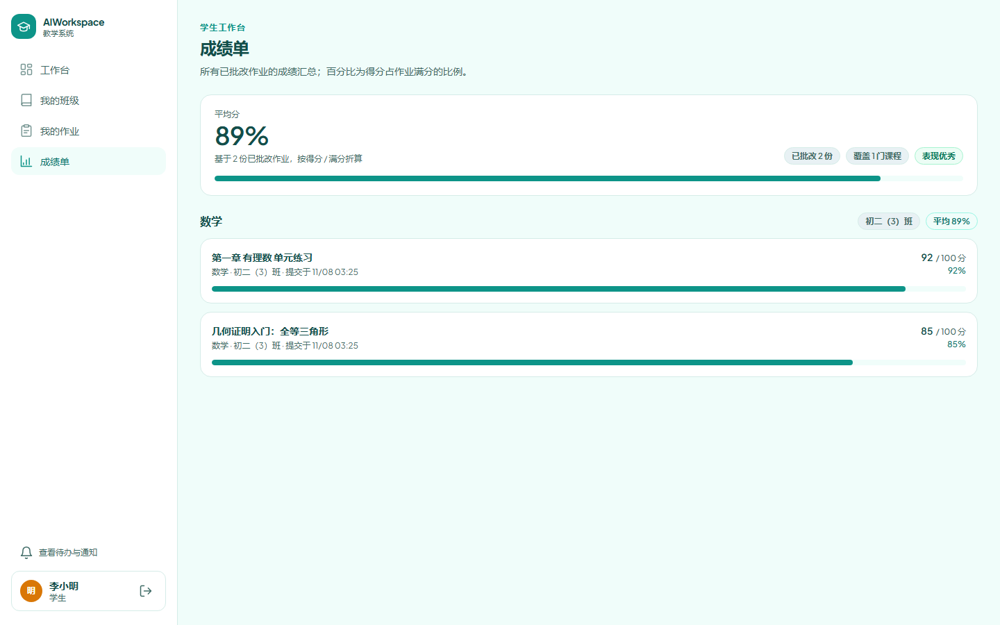

# AIWorkspace · 教学系统

面向学校 **教师** 与 **学生** 的轻量网页教学系统：班级与成员、课程、作业发布与提交、批改与成绩、班级公告。

项目基底已完成 Docker 封装，**宿主机 3100 端口** 即可访问；数据用 SQLite 持久化在容器卷里，适合校内单机部署或演示。

> 本仓库是项目底座（可直接运行的最小可用版本）。Git 远端：`https://github.com/Williamwei20130122/AIWorkspace`。

---

## 1. 功能一览

### 教师端

- 工作台：班级数 / 学生数 / 课程数 / 待批改统计，最近提交与即将截止作业
- 班级管理：创建班级（自动生成 6 位邀请码）、查看学生名单
- 课程管理：在班级下建课
- 作业：发布作业（标题、要求、分值、截止时间）、查看提交进度、逐份批改打分与评语
- 公告：向班级发布通知

### 学生端

- 工作台：待交作业 / 已提交 / 平均分 / 班级数，最近公告
- 加入班级：凭 6 位邀请码
- 作业：查看作业要求与截止时间、提交 / 重新提交
- 成绩：查看已批改作业的得分、百分比与教师评语

### 演示账号（首次启动自动创建）

| 角色 | 邮箱 | 密码 |
| --- | --- | --- |
| 教师 | `teacher@demo.edu` | `demo1234` |
| 学生 | `student@demo.edu` | `demo1234` |

其他演示学生：`xiaohong@demo.edu` / `xiaojun@demo.edu` / `xiaomei@demo.edu`，密码相同。
班级邀请码：`MATH01`、`MATH02`。

### 界面预览

| 登录 | 教师工作台 | 学生成绩单 |
| --- | --- | --- |
|  |  |  |

更多页面截图在 [`docs/screenshots/`](docs/screenshots/)（教师班级/作业批改、学生作业提交等）。
截图由 `node scripts/capture-screenshots.mjs` 用本机无头 Edge/Chrome 自动生成。

---

## 2. 技术栈

| 层 | 选型 |
| --- | --- |
| 框架 | Next.js 15（App Router / Server Components / Server Actions） |
| 语言 | TypeScript 5（strict） |
| 样式 | Tailwind CSS v4（CSS-first，`src/app/globals.css`） |
| 数据 | Prisma 6 + SQLite |
| 校验 | zod 3 |
| 部署 | Docker 多阶段构建（standalone 产物），宿主端口 **3100** |

---

## 3. 目录结构

```
.
├── src/
│   ├── app/                 # 路由（App Router）
│   │   ├── actions/         # Server Actions（auth / teacher / student）
│   │   ├── api/health/      # 健康检查（Docker healthcheck）
│   │   ├── login/           # 登录页
│   │   ├── teacher/         # 教师端页面
│   │   └── student/         # 学生端页面
│   ├── components/
│   │   ├── ui/              # 通用展示组件
│   │   ├── shell/           # 侧栏框架
│   │   ├── auth/            # 登录表单
│   │   ├── teacher/         # 教师端交互组件
│   │   └── student/         # 学生端交互组件
│   └── lib/                 # prisma / auth / data / format / roles
├── prisma/
│   ├── schema.prisma        # 数据模型
│   ├── migrations/          # 迁移
│   ├── seed.mjs             # 演示数据
│   └── ensure-seed.mjs      # 容器启动时空库自动灌数据
├── docs/                    # 需求、架构、设计系统、开发契约
├── docker/entrypoint.sh     # 容器入口（迁移 → 种子 → 启动）
├── Dockerfile
├── docker-compose.yml
└── package.json
```

---

## 4. 本地开发（不需要 Docker）

环境要求：Node.js **>= 20.9**（推荐 22）、npm 10+。

```bash
# 1. 安装依赖
npm install

# 2. 配置环境变量
cp .env.example .env
#   Windows PowerShell: Copy-Item .env.example .env
#   把 AUTH_SECRET 换成随机长字符串：
#   node -e "console.log(require('crypto').randomBytes(48).toString('base64url'))"

# 3. 建库 + 迁移 + 演示数据
npm run db:migrate
npm run db:seed

# 4. 启动（开发模式，热更新）
npm run dev
```

打开 http://localhost:3100 ，用上面的演示账号登录。

### 常用脚本

| 命令 | 说明 |
| --- | --- |
| `npm run dev` | 开发服务器，端口 3100 |
| `npm run build` | 生成 Prisma Client + 生产构建 |
| `npm run start` | 以生产模式启动（需先 build） |
| `npm run typecheck` | TypeScript 全量检查 |
| `npm run db:migrate` | 创建/应用迁移（开发） |
| `npm run db:deploy` | 应用已有迁移（生产） |
| `npm run db:seed` | 重置并写入演示数据（会清空现有数据！） |
| `npm run db:studio` | Prisma Studio 可视化管理数据 |

---

## 5. Docker 部署（3100 端口）

```bash
# 1. 准备环境变量
cp .env.example .env
#   修改 .env 里的 AUTH_SECRET 为随机值（compose 会自动读取 .env）

# 2. 构建并启动
docker compose up -d --build

# 3. 查看状态与日志
docker compose ps
docker compose logs -f web

# 4. 访问
#    http://localhost:3100
#    健康检查：http://localhost:3100/api/health
```

- 端口映射：`3100:3100`（容器内 Next.js 也监听 3100，可用 `PORT` 覆盖）。
- 数据持久化：命名卷 `aiworkspace-data` → 容器内 `/data/app.db`；`docker compose down` 不会丢数据，`down -v` 会删卷。
- 首次启动（空库）会执行 `prisma migrate deploy` 并自动写入演示数据；要关闭演示数据：`SEED_ON_START=0 docker compose up -d`。
- 重置数据：`docker compose down -v && docker compose up -d --build`。

### 构建参数（网络环境相关）

默认已针对国内网络做了处理，一般直接 `docker compose up -d --build` 即可：

| 参数 / 变量 | 默认 | 说明 |
| --- | --- | --- |
| `BASE_IMAGE` | `docker.m.daocloud.io/library/node:22-alpine` | 基础镜像走国内镜像源；能直连 Docker Hub 时用 `--build-arg BASE_IMAGE=node:22-alpine` 覆盖 |
| `NPM_REGISTRY` | `https://registry.npmjs.org` | 构建时 npm 源；国内可 `--build-arg NPM_REGISTRY=https://registry.npmmirror.com` |
| `PRISMA_ENGINES_MIRROR` | `https://registry.npmmirror.com/-/binary/prisma` | Prisma 引擎下载镜像（Dockerfile 内已设置） |

> 镜像内以非 root 用户 `nextjs` 运行；Prisma CLI 单独安装在 `/app/prisma-cli`，启动时只做 `migrate deploy`，不把开发依赖带进运行镜像。

### 不用 compose，直接 docker run

```bash
docker build -t aiworkspace:latest .
docker run -d --name aiworkspace-web -p 3100:3100 \
  -v aiworkspace-data:/data \
  -e AUTH_SECRET="$(node -e "console.log(require('crypto').randomBytes(48).toString('base64url'))")" \
  aiworkspace:latest
```

---

## 6. 环境变量

| 变量 | 默认 | 说明 |
| --- | --- | --- |
| `DATABASE_URL` | `file:./dev.db`（本地）/ `file:/data/app.db`（容器） | SQLite 文件路径 |
| `AUTH_SECRET` | 无（生产必须配置） | 会话 Cookie 签名密钥，泄露=可伪造登录 |
| `PORT` | `3100` | 监听端口 |
| `SEED_ON_START` | `1` | 容器空库时是否写入演示数据 |

---

## 7. 协作约定（Git）

- 主分支：`main`（受保护，合并走 PR）
- 功能开发：`feat/<模块>`、修复：`fix/<问题>`；提交信息用中文或英文均可，建议 `feat: 教师端作业批改` 格式
- 提交前自查：`npm run typecheck && npm run build`
- 数据模型变更必须提交新的 Prisma migration（`npm run db:migrate` 生成，随代码一起提交）
- 关键接口变化同步更新 [`docs/CONTRACT.md`](docs/CONTRACT.md)

---

## 8. 后续可迭代

- 学生作业附件上传（图片/PDF）
- 通知与提醒（站内信 / 邮件）
- 多班级、多学校与管理员后台
- 成绩统计图表、导出 Excel/PDF
- 迁移到 PostgreSQL（Prisma 改 datasource 即可）
- 单元测试（Playwright E2E / Vitest）与 CI

---

## 9. 文档

- [`docs/requirements.md`](docs/requirements.md) —— 需求范围与验收标准
- [`docs/architecture.md`](docs/architecture.md) —— 架构、请求流程、数据模型
- [`docs/design-system.md`](docs/design-system.md) —— 设计系统与组件规范
- [`docs/CONTRACT.md`](docs/CONTRACT.md) —— 前后端接口契约（改接口先读这个）
