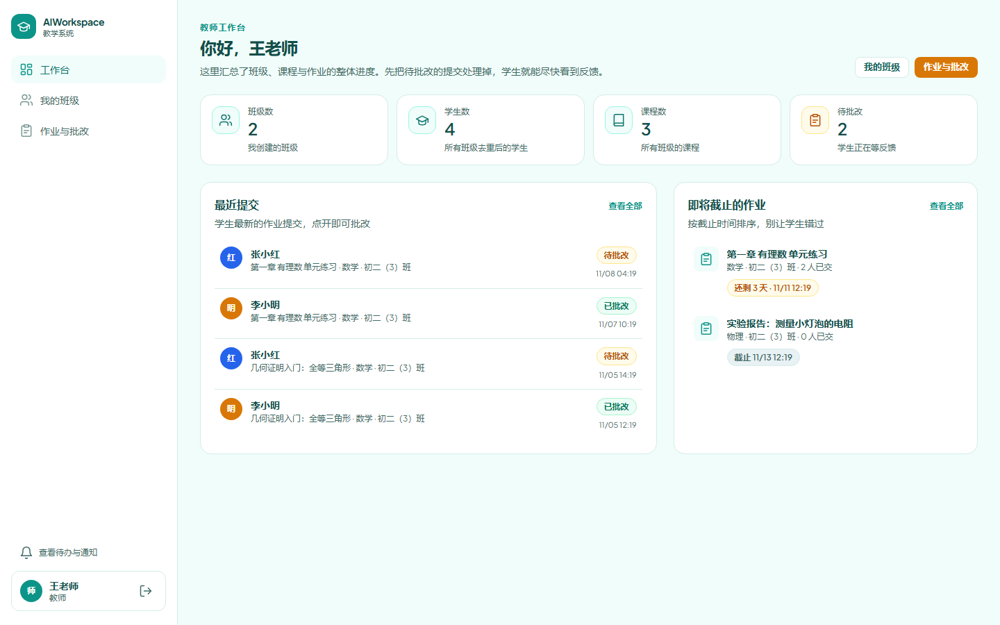

# AIWorkspace · 教学系统（Go 后端 + TS 前端）

面向学校 **教师** 与 **学生** 的轻量网页教学系统：班级与成员、课程、作业发布与提交、批改与成绩、班级公告。

技术栈：**Go 1.27**（标准库 HTTP + 纯 Go SQLite）+ **React 19 / Vite / TypeScript / Tailwind CSS v4**；单容器 Docker 部署，宿主机 **3100 端口** 访问。

> Git 远端：`https://github.com/Williamwei20130122/AIWorkspace`
> Next.js 全栈版基底保留在 `feat/project-base` 分支（v1），当前主线为 `feat/go-ts`。

---

## 1. 功能一览

### 教师端

- 工作台：班级数 / 学生数 / 课程数 / 待批改统计，最近提交与即将截止作业
- 班级管理：创建班级（自动生成 6 位邀请码）、查看学生名单
- 课程管理：在班级下建课
- 作业：发布作业（标题、要求、分值、截止时间）、查看提交进度、逐份批改打分与评语
- 公告：向班级发布通知

### 学生端

- 工作台：待交作业 / 已提交 / 平均分 / 班级数，最近公告
- 加入班级：凭 6 位邀请码
- 作业：查看作业要求与截止时间、提交 / 重新提交
- 成绩：查看已批改作业的得分、百分比与教师评语

### 演示账号（首次启动自动创建）

| 角色 | 邮箱 | 密码 |
| --- | --- | --- |
| 教师 | `teacher@demo.edu` | `demo1234` |
| 学生 | `student@demo.edu` | `demo1234` |

其他演示学生：`xiaohong@demo.edu` / `xiaojun@demo.edu` / `xiaomei@demo.edu`，密码相同。
班级邀请码：`MATH01`、`MATH02`。

### 界面预览

| 登录 | 教师工作台 | 学生成绩单 |
| --- | --- | --- |
|  |  |  |

更多截图在 [`docs/screenshots/`](docs/screenshots/)，由 `node scripts/capture-screenshots.mjs` 自动生成。

---

## 2. 技术栈与结构

| 层 | 选型 |
| --- | --- |
| 后端 | Go 1.27，`net/http` 路由；`modernc.org/sqlite`（纯 Go，无需 CGO） |
| 前端 | React 19 + Vite + TypeScript strict + Tailwind CSS v4 + React Router 7 |
| 认证 | scrypt 口令哈希 + HMAC-SHA256 签名 HttpOnly Cookie（`aw_session`） |
| 数据 | SQLite 文件：本地 `server/data/app.db`，容器 `/data/app.db`；启动自动建表 |
| 部署 | Docker 多阶段：Vite 构建 → Go 构建（`go:embed` 内嵌前端）→ alpine |

```
server/                    Go 后端
  cmd/server/main.go       入口（环境变量、建库、种子、HTTP 服务、内嵌前端）
  internal/db/             schema.sql、建库、种子
  internal/auth/           scrypt、会话签名、鉴权中间件
  internal/handlers/       auth / teacher / student / health
  internal/models/         JSON 结构体
  webdist/                 go:embed 的前端产物（构建时由 web/dist 覆盖）
web/                       Vite + React 前端
  src/pages/               页面（teacher/、student/、Login）
  src/components/          ui、shell、auth、teacher、student
  src/lib/                 api、types、format、roles
docs/                      需求、架构、设计系统、开发契约、截图
scripts/                   截图等开发脚本
Dockerfile / docker-compose.yml
```

---

## 3. 本地开发

环境要求：**Go 1.27+**、**Node.js 22+**、npm 10+。

### 后端（:3100）

```bash
cd server
# 首次需要设置环境变量（PowerShell 示例；bash 用 export）
$env:AUTH_SECRET="dev-secret-change-me"
$env:DATABASE_PATH="./data/app.db"
$env:SEED_ON_START="1"
go run ./cmd/server
```

健康检查：`http://localhost:3100/api/health`。

### 前端（:5173，自动代理 /api 到 :3100）

```bash
cd web
npm install
npm run dev
```

打开 http://localhost:5173 ，用演示账号登录。

### 生产构建（单端口 3100）

```bash
cd web && npm ci && npm run build
cd ../server && go build -o ../aiworkspace ./cmd/server
# 把 web/dist 放进 server/webdist 再编译（go:embed 需要）
```

> 也可以直接 `docker compose up -d --build`，Dockerfile 会自动完成前后端构建与内嵌。

---

## 4. Docker 部署（3100 端口）

```bash
cp .env.example .env     # 修改 AUTH_SECRET 为随机值
docker compose up -d --build
docker compose logs -f web
# 打开 http://localhost:3100
```

- 端口映射 `3100:3100`（容器内 Go 服务监听 3100）。
- 数据持久化：命名卷 `aiworkspace-data` → `/data/app.db`；`down` 不丢数据，`down -v` 重置。
- 空库首次启动自动写演示数据；`SEED_ON_START=0` 关闭。
- 健康检查：容器内 `wget http://127.0.0.1:3100/api/health`。

### 构建参数（网络环境）

| 参数 | 默认 | 说明 |
| --- | --- | --- |
| `BASE_NODE` | `docker.m.daocloud.io/library/node:22-alpine` | 前端构建镜像 |
| `BASE_GO` | `docker.m.daocloud.io/library/golang:1.27-alpine` | Go 构建镜像 |
| `BASE_RUN` | `docker.m.daocloud.io/library/alpine:3.22` | 运行镜像 |
| `NPM_REGISTRY` | `https://registry.npmjs.org` | compose 已覆盖为 npmmirror |
| `GOPROXY` | `https://goproxy.cn,direct` | compose 已覆盖为国内代理 |

---

## 5. 环境变量

| 变量 | 默认 | 说明 |
| --- | --- | --- |
| `AUTH_SECRET` | 无（生产必须配置） | 会话 Cookie 签名密钥 |
| `PORT` | `3100` | 监听端口 |
| `DATABASE_PATH` | `./data/app.db`（本地）/ `/data/app.db`（容器） | SQLite 文件路径 |
| `SEED_ON_START` | `1` | 空库时是否写演示数据 |

---

## 6. 协作约定（Git）

- 主分支：`main`；功能分支：`feat/<模块>`、修复：`fix/<问题>`
- 提交前：`cd web && npm run build`；`cd server && go vet ./... && go build ./...`
- 接口/数据模型变更必须同步更新 [`docs/CONTRACT.md`](docs/CONTRACT.md)
- 交付流程：分支 → PR（`gh pr create --draft`）→ 评审合并

---

## 7. 后续可迭代

- 学生作业附件上传（图片/PDF）
- 通知与提醒（站内信 / 邮件）
- 多学校与管理员后台
- 成绩统计图表、导出 Excel/PDF
- 迁移 PostgreSQL
- 自动化测试（Playwright E2E / Go httptest）与 CI

---

## 8. 文档

- [`docs/requirements.md`](docs/requirements.md) —— 需求与验收标准
- [`docs/architecture.md`](docs/architecture.md) —— 架构与请求流程（v1 架构说明，Go 版见 CONTRACT）
- [`docs/design-system.md`](docs/design-system.md) —— 设计系统
- [`docs/CONTRACT.md`](docs/CONTRACT.md) —— API/数据模型/前端约定
